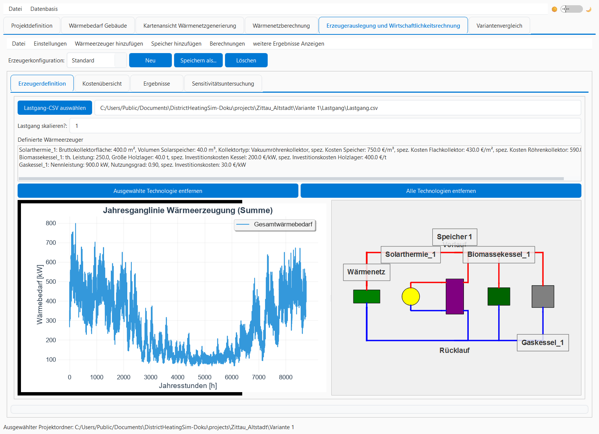

# DistrictHeatingSim

## Introduction

Welcome to the DistrictHeatingSim project, a comprehensive tool for planning and optimizing sustainable district heating networks. This README provides an overview of the project's functionality, installation instructions, and usage guidelines.

The software integrates technical and economic simulations to support the design and evaluation of district heating systems. Besides the technical methods for calculations, a huge focus lies on implementing a GUI for this process steps. The Tool is implemented as an PyQt6-GUI.

DistrictHeatingSim was originally developed at the University of Applied Science Zittau/Görlitz by Dipl.-Ing. (FH) Jonas Pfeiffer as part of a preliminary research SMWK-NEUES TG70 project, which focuses on the development and testing of methods and tools for the conceptualization of sustainable heating networks. The work is now being continued within an EFRE-ESF founded Junior Research Group "Energy Storage" at the University of Applied Science Zittau/Görlitz.

## Table of Contents
1. [Features](#features)
2. [Installation](#installation)
3. [Usage](#usage)
    - [Building Heat Demand Profile Calculation](#building-heat-demand-profile-calculation)
    - [Spatial Analysis](#spatial-analysis)
    - [Heat Network Calculation](#heat-network-calculation)
    - [Generator Sizing and Economic Analysis](#generator-sizing-and-economic-analysis)
4. [Requirements](#requirements)
5. [Testing](#testing)
6. [Project Structure](#project-structure)
7. [Documentation](#documentation)
8. [Publication](#publication)
9. [Contribution Guidelines](#contribution-guidelines)
10. [License](#license)
11. [Contact Information](#contact-information)

## Features

The user interface is German; a German user guide ("Benutzerhandbuch") walks through a first
quarter step by step: https://districtheatingsim.readthedocs.io/en/latest/benutzerhandbuch.html

### User Interface
- **New-project assistant**: name and folder, place search with a CRS suggestion, climate data
  (DWD test reference year, climate zone) and the source of the buildings.
- **Buildings**: import address tables (CSV or Excel exports, column mapping, value check),
  convert OpenStreetMap buildings (addresses, estimated demand) or enter them by hand; geocoding
  with a report of addresses found only to the street or town.
- **Heat demand**: hourly load profiles per building after BDEW or VDI 4655 with the project's
  climate data ([pyslpheat](https://github.com/JonasPfeiffer123/pyslpheat)).
- **Map and network generation**: OpenStreetMap streets, automatic network generation (MST,
  OSMnx), editing of the supply line with automatic return and house connections, connectivity
  check; the map editor works offline (only the base map and the OSM downloads need internet).
- **Thermohydraulic network calculation** with [pandapipes](https://github.com/e2nIEE/pandapipes):
  pipe sizing by velocity and friction pressure loss, pump design on the worst house station,
  simplified or detailed yearly time series with progress and cancel.
- **Generator sizing and economics**: gas and biomass boilers, CHP, solar thermal, heat pumps,
  power-to-heat and a stratified network storage; costs after
  [VDI 2067](https://www.vdi.de/richtlinien/details/vdi-2067-blatt-1-wirtschaftlichkeit-gebaeudetechnischer-anlagen-grundlagen-und-kostenberechnung-1),
  CO₂ and primary energy, optimisation of the plant sizes, sensitivity analysis.
- **Plausibility traffic light** next to the results (loss share, heat density, pressure loss,
  storage per collector area) with threshold and source.
- **Variants and comparison**: several variants per project and several generator
  configurations per variant; outdated results are marked after inputs change.

### Technical Capabilities
- Calculation methods, default values and the sources of the thresholds are documented in
  "Berechnungsmethodik": https://districtheatingsim.readthedocs.io/en/latest/berechnungsmethodik.html
- Results are stored per project as GeoJSON, CSV, JSON and Parquet; the pandapipes network as
  JSON.
- The domain core (`heat_generators`, `net_simulation_pandapipes`, `heat_requirement`, …) runs
  without the GUI; the `examples/` folder shows it in scripts.

## Installation

To install DistrictHeatingSim, follow the steps below. The software is tested on Python 3.11 and 3.12 (see CI). Ensure that you have Python installed on your system before proceeding. Alternatively, you can use Miniconda for managing dependencies.

### Option 1: Install via pip
1. Open a terminal or command prompt.
2. Install the repository directly from GitHub using the following command:
    ```sh
    pip install git+https://github.com/JonasPfeiffer123/DistrictHeatingSim.git
    ```

### Option 2: Manual Installation
1. Clone the repository to your local machine:
    ```sh
    git clone https://github.com/JonasPfeiffer123/DistrictHeatingSim.git
    ```
2. Navigate to the project directory:
    ```sh
    cd DistrictHeatingSim
    ```
3. Install the package:
    ```sh
    pip install .
    ```
4. Run the application using the installed entry point:
    ```sh
    districtheatingsim
    ```
    (equivalently `python -m districtheatingsim`)

### Troubleshooting
- If you encounter errors during installation or while running the application, ensure that all required Python modules are installed. All dependencies are declared in `pyproject.toml` and (re)installed via:
    ```sh
    pip install .
    ```
- Installation pulls two dependencies directly from GitHub (`pyslpheat` and `thermal-energy-storage-1d`), so `git` must be available on your system.
- Verify that all necessary data files are present in the appropriate directories.
- If issues persist, please report them on the [GitHub Issues page](https://github.com/JonasPfeiffer123/DistrictHeatingSim/issues) with detailed information about the error.

By following these steps, you should be able to successfully install and run DistrictHeatingSim on your system.

## Usage

Start DistrictHeatingSim with the `districtheatingsim` command (installed by `pip install .`), or
`python -m districtheatingsim`. The welcome screen creates a new project with the assistant
("Neues Projekt") or opens an existing one; the bundled Görlitz example opens as a working copy in
`Documents/DistrictHeatingSim`. The screenshots below show the Zittau example of the user guide
(15 buildings of the old town).

### Buildings ("Projektdefinition")

1. **Import** an address table ("Datei → CSV importieren"); tables in another format are mapped
   column by column, and the values are checked before anything is saved.
2. **Geocode** the addresses; rows found only to the street or town are marked.
3. The progress tracker shows which steps are done and which results are outdated.


### Heat Demand ("Wärmebedarf Gebäude")

1. **Calculate** the hourly load profiles of all buildings (BDEW or VDI 4655) with the project's
   test reference year and climate zone.
2. **View** the profiles per building in the diagram; they are saved with the project.


### Map and Network ("Kartenansicht Wärmenetzgenerierung")

1. **Streets**: download the OpenStreetMap streets around the buildings.
2. **Network**: generate the supply network with the producer location (MST or OSMnx); house
   connections and the return line follow automatically.
3. **Edit** the supply line on the map if needed; "Konnektivität prüfen" finds gaps.


### Network Calculation ("Wärmenetzberechnung")

1. **Initialise** the network in pandapipes: supply temperatures, pipe type and the sizing limits
   (velocity and friction pressure loss); the pump is designed for 1 bar at the worst station.
2. **Time series**: simplified (seconds) or detailed (minutes to hours) over the year.
3. **Results**: network plot, pipe table, key figures and the plausibility traffic light.


### Generator Sizing and Economics ("Erzeugerauslegung und Wirtschaftlichkeitsrechnung")

1. **Generators**: add generators and storages in the order they serve the load; the schematic
   shows the plant.
2. **Costs**: economic parameters and infrastructure costs (estimated from the network until you
   enter your own).
3. **Calculate or optimise**: heat generation, heat generation costs, CO₂ and primary energy per
   generator, the plausibility check; save each configuration and export the time series as CSV.
4. **Compare** variants and configurations in "Variantenvergleich".



## Requirements

- **Python Version**: >= 3.11
- Dependencies are declared in `pyproject.toml` and installed automatically via `pip install .`
- For documentation dependencies: `pip install ".[docs]"`

## Testing

The project ships an automated `pytest` suite covering the GUI-free domain core
(heat generators, VDI 2067 economics, the energy-system orchestrator), the
pandapipes simulation layer, and smoke tests that run the `examples/` scripts.
GitHub Actions runs the suite on Python 3.11 and 3.12.

1. Install the development dependencies (pytest + ruff):
    ```sh
    pip install -e ".[dev]"
    ```
2. Run the suite:
    ```sh
    pytest                  # full suite
    pytest -m "not slow"    # skip the slow pandapipes / example tests
    ```
3. Lint:
    ```sh
    ruff check .
    ```

`tests/e2e/` holds GUI end-to-end scenarios that drive the real main window (see
`tests/e2e/README.md`); they use live web services and are not part of `pytest`.
`tests/e2e/docs_screenshots.py` takes the screenshots of this README and of the user guide.

## Project Structure

- **src/districtheatingsim**: Source code for DistrictHeatingSim
- **docs/**: Documentation for DistrictHeatingSim
- **examples/**: Contains multiple Examples for the various base functionalities of the software.
- **tests/**: Automated pytest suite (domain core, simulation, examples smoke tests)
- **images/**: Contains examples of the GUI
- **pyproject.toml**: Project metadata and dependency declarations
- **README.md**: This README file

## Windows Executable (PyInstaller)
A Windows build without a Python installation is made with PyInstaller (`python build.py`);
`PYINSTALLER_BUILD_GUIDE_EN.md` describes the prerequisites, the build files and how to check
the result.

## Documentation
The documentation at https://districtheatingsim.readthedocs.io/en/latest/ contains the German
user guide ("Benutzerhandbuch"), the calculation methods ("Berechnungsmethodik") and the API
reference generated from the docstrings with [Sphinx](https://www.sphinx-doc.org/en/master/).
To build it locally:

1. **Install the documentation dependencies** (Sphinx, readthedocs theme, etc.):
    ```sh
    pip install ".[docs]"
    ```

2. **Build the HTML documentation**:
    ```sh
    cd docs
    make clean
    make html
    ```

The API pages in `docs/source/districtheatingsim.*.rst` are maintained by hand (a module added to
the package needs an `automodule` entry there); `sphinx-apidoc -f` would overwrite the curated
pages.

### Documentation Style Guide

To ensure consistency across the codebase, all Python code should follow these documentation standards:

**Docstring Format**: Sphinx/reStructuredText (reST)

#### Module Headers

Every Python module must start with a module-level docstring following this format:

```python
"""
Module Title
============

Brief description of what this module does.

:author: name
"""
```

#### Function/Method Documentation

**Required Elements**:
- **Summary**: Brief one-line description of the function/class
- **Parameters**: Description of all parameters (use `:param:` and `:type:`)
- **Returns**: Description of return values (use `:return:` and `:rtype:`)
- **Raises**: Exceptions that may be raised (use `:raises:`)

**Example**:
```python
def calculate_heat_demand(building_area, building_type, weather_data):
    """
    Calculate the heat demand for a building based on area, type, and weather data.
    
    :param building_area: Area of the building in square meters
    :type building_area: float
    :param building_type: Type of building (e.g., 'residential', 'commercial')
    :type building_type: str
    :param weather_data: Weather data for the calculation period
    :type weather_data: pd.DataFrame
    :return: Calculated heat demand profile
    :rtype: pd.Series
    :raises ValueError: If building_area is negative or building_type is invalid
    
    .. note::
        This function uses BDEW standard load profiles for the calculation.
    """
    pass
```

**Guidelines**:
- Keep docstrings concise but informative
- Document all public functions, classes, and methods
- Use type hints in function signatures where possible
- Add examples for complex functions using `.. code-block::` or doctest format
- Private methods (starting with `_`) should have brief docstrings
- Use `.. note::` for important information or implementation details

## Publication

**Supporting the Transformation of Heat Supply: Development of a Software Solution for Sustainable Heating Networks**  
Jonas Pfeiffer, Matthias Kunick
**Published in:** *Proceedings of the 25th Young Scientists Conference*  
Hochschule Merseburg, 2025, pp. 128–132  
[📎 View PDF](https://www.hs-merseburg.de/fileadmin/Forschung/Nachwuchswissenschaftlerkonferenz/NWK25/NWK25_Tagungsband.pdf)

**Development of an integrated software workflow for district heating network planning: A structured methodological approach**  
Jonas Pfeiffer, Matthias Kunick  
**Published in:** *ACC Journal*, 31(1), 48–63, 2025  
[https://doi.org/10.2478/acc-2025-0004](https://doi.org/10.2478/acc-2025-0004)

## Contribution Guidelines

I welcome contributions from the community. To contribute:

1. Fork the repository.
2. Create a new branch for your feature or bug fix.
3. Make your changes and commit them with descriptive messages.
4. Push your changes to your forked repository.
5. Open a pull request to the main repository.

Please ensure that your contributions align with the project's coding standards and add tests for new functionalities.

## Known Issues and Future Work

For a list of known issues, planned features, and ongoing development tasks, please refer to:
- [GitHub Issues](https://github.com/JonasPfeiffer123/DistrictHeatingSim/issues)

## License

DistrictHeatingSim is licensed under the GPL v3 License. See the `LICENSE` file for more details.

## Funding Notice

This project was funded by the Free State of Saxony as part of the SMWK-NEUES TG70 initiative. The funding supports the development and testing of methods and tools for the conceptualization of sustainable heating networks. The work is now being continued within an EFRE-ESF founded Junior Research Group "Energy Storage" at the University of Applied Science Zittau/Görlitz.


## Contact Information

For further information, questions, or feedback, please contact the project maintainer:

Dipl.-Ing. (FH) Jonas Pfeiffer

[GitHub Profile](https://github.com/JonasPfeiffer123)  

Email: jonas.pfeiffer(at)hszg.de

[LinkedIn](https://de.linkedin.com/in/jonas-pfeiffer-0357691a2)

