Benutzerhandbuch: Mein erstes Quartier
======================================

Dieses Handbuch führt einmal durch den ganzen Ablauf: vom leeren Projekt bis zum Vergleich zweier
Versorgungsvarianten. Beispiel ist ein Ausschnitt der Zittauer Altstadt mit 15 Gebäuden
(Verwaltung, Handel, Gastronomie und Wohnhäuser). Wie das Programm im Hintergrund rechnet,
beschreibt die :doc:`berechnungsmethodik`.

.. contents:: Inhalt
   :local:
   :depth: 1

**Was Sie brauchen**

* DistrictHeatingSim (Installation siehe Startseite) oder die Windows-Version.
* Eine Gebäudeliste mit Adressen und Jahreswärmebedarf (Format siehe :ref:`gebaeudeliste`).
* Internet für die Ortssuche, das Geocoding der Adressen und die Straßendaten von OpenStreetMap.
  Der Rest – Karte bearbeiten, Netz und Erzeuger berechnen – geht auch offline.

Der Durchlauf dauert etwa eine halbe Stunde. Alle Ergebnisse liegen im Projektordner; das
Programm speichert beim Verlassen eines Projekts nur, was sich geändert hat, und fragt vorher.

1. Programmstart
----------------

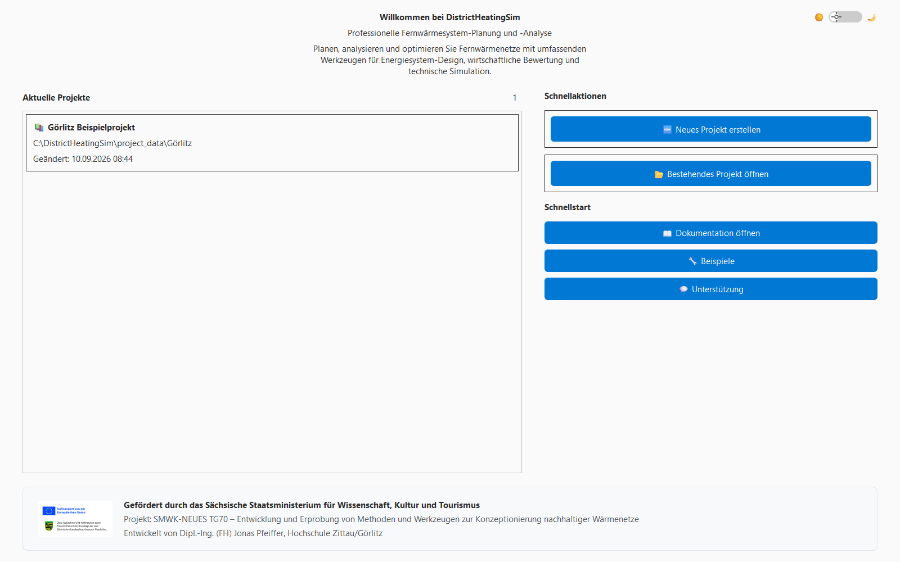

   Die Willkommensseite.

Die Willkommensseite bietet:

* **Neues Projekt erstellen** – startet den Assistenten (Abschnitt 2),
* **Bestehendes Projekt öffnen** und die Liste **Aktuelle Projekte**,
* in dieser Liste das **Görlitz Beispielprojekt**: Es öffnet sich als Arbeitskopie unter
  ``Dokumente/DistrictHeatingSim``, das mitgelieferte Original bleibt unverändert,
* in der Titelzeile den Wechsel zwischen hellem und dunklem Erscheinungsbild.

Über **Datei → 🏠 Zurück zum Start** kommen Sie später jederzeit hierher zurück.

2. Neues Projekt anlegen
------------------------

Der Assistent fragt in drei Schritten alles ab, was das Projekt von Anfang an braucht.

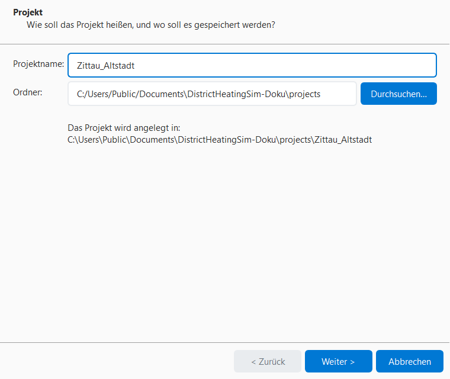

   Schritt 1: Name und Ordner.

**Name und Ordner.** Unter dem gewählten Ordner entsteht ein Projektordner mit dem Namen. Ein
schon vorhandener Name oder Zeichen, die Windows in Ordnernamen nicht erlaubt, werden sofort
angezeigt; „Weiter“ bleibt dann gesperrt.

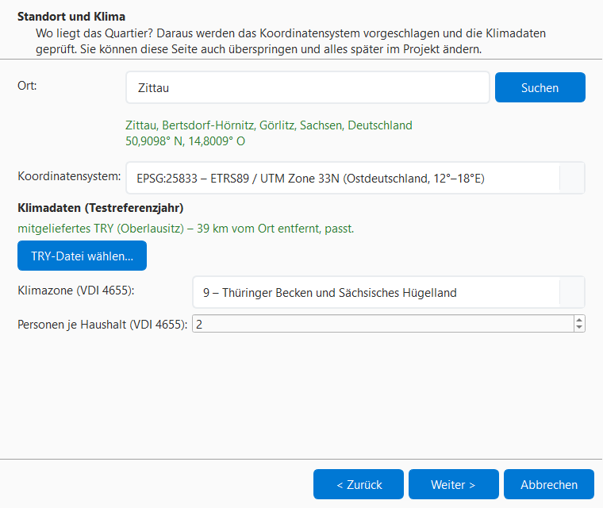

   Schritt 2: Standort und Klima.

**Standort und Klima.** Nach der Ortssuche schlägt der Assistent das passende Koordinatensystem
vor (in Ostdeutschland UTM-Zone 33, im Westen Zone 32) und prüft das Testreferenzjahr (TRY) des
Deutschen Wetterdienstes:

* Das mitgelieferte TRY gilt für die Oberlausitz. Liegt Ihr Ort mehr als 50 km davon entfernt,
  laden Sie über den angezeigten Link das TRY Ihres Standorts beim DWD herunter und wählen es mit
  **TRY-Datei wählen…** aus.
* **Klimazone** und **Personen je Haushalt** brauchen nur Wohngebäude nach VDI 4655.

Sie können den Schritt überspringen und alles später im Reiter *Projektdefinition* bzw. unter
**Datenbasis → Klimadaten (TRY) festlegen** einstellen.

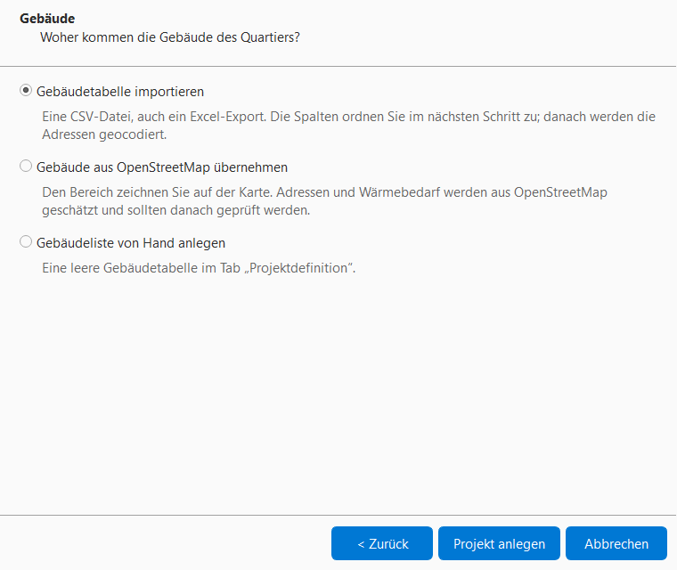

   Schritt 3: Woher kommen die Gebäude?

**Gebäude.** Drei Wege stehen zur Wahl:

* **Tabelle importieren** – eine Adressliste als CSV-Datei (auch ein Excel-Export),
* **OpenStreetMap** – Gebäude in einem Gebiet auf der Karte abfragen; Adressen kommen aus OSM,
  der Wärmebedarf wird aus Grundfläche und Geschosszahl geschätzt und sollte geprüft werden,
* **von Hand** – eine leere Tabelle, in die Sie die Gebäude eintragen.

Im Beispiel wird die Tabelle ``zittau_quartier.csv`` importiert. Nach dem Assistenten zeigt das
Programm eine Zusammenfassung und öffnet den Dateidialog für den Import.

Der Projektordner enthält danach:

=============================  ===============================================================
Ordner                         Inhalt
=============================  ===============================================================
``Definition Quartier IST``    die Gebäudeliste ``Quartier IST.csv``
``Eingangsdaten allgemein``    Straßen und weitere Geodaten
``Klimadaten``                 das Testreferenzjahr des Projekts
``Wärmepumpendaten``           das COP-Kennfeld der Wärmepumpen
``Variante 1``                 Lastgänge, Wärmenetz und Ergebnisse dieser Variante
=============================  ===============================================================

.. _gebaeudeliste:

3. Gebäude importieren und verorten
-----------------------------------

Die Gebäudeliste
~~~~~~~~~~~~~~~~

Je Gebäude eine Zeile, Trennzeichen Semikolon. Diese Spalten werden gebraucht:

=======================  ===================================================================
Spalte                   Bedeutung
=======================  ===================================================================
``Land``                 z. B. Deutschland
``Bundesland``           z. B. Sachsen
``Stadt``                z. B. Zittau
``Adresse``              Straße und Hausnummer
``Wärmebedarf``          Jahreswärmebedarf in kWh (Heizung und Warmwasser)
``Gebäudetyp``           Typkürzel, siehe unten
``WW_Anteil``            Anteil des Warmwassers am Wärmebedarf (0–1, z. B. 0,2)
``VLT_max``              höchste Vorlauftemperatur der Heizung in °C
``Steigung_Heizkurve``   Steigung der Heizkurve (z. B. 1,5)
``RLT_max``              höchste Rücklauftemperatur in °C
``Normaußentemperatur``  Auslegungsaußentemperatur nach DIN EN 12831 in °C
=======================  ===================================================================

Optional sind ``Subtyp``, ``Typ_Heizflächen`` (HK = Heizkörper, FBH = Fußbodenheizung) und für
BDEW-Profile ``Heizgrenztemperatur``, ``Heizexponent`` und ``P_max``. Nach dem Geocoding kommen
die Koordinaten ``UTM_X`` und ``UTM_Y`` hinzu.

**Gebäudetypen.** Ein Projekt rechnet mit *einem* Verfahren:

* **BDEW** (Standardlastprofile) für gemischte Quartiere: ``HEF`` Einfamilienhaus, ``HMF``
  Mehrfamilienhaus und die Gewerbetypen ``GKO``, ``GHA``, ``GMK``, ``GBD``, ``GBH``, ``GWA``,
  ``GGA``, ``GBA``, ``GGB``, ``GPD``, ``GMF``, ``GHD``,
* **VDI 4655** für reine Wohnquartiere: ``EFH``, ``MFH``.

Wohngebäude in einem BDEW-Quartier tragen also ``HEF`` oder ``HMF``.

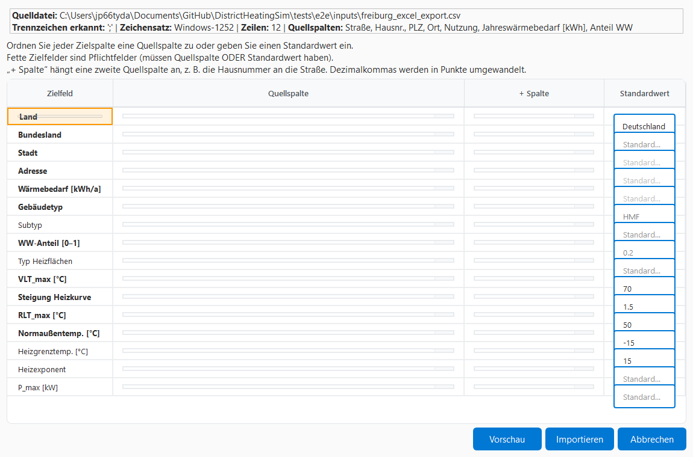

   Zuordnung der Spalten einer Tabelle in einem anderen Format (hier ein Excel-Export).

**Andere Tabellen.** Hat Ihre Tabelle andere Spaltennamen, öffnet der Import die Zuordnung: Links
stehen die benötigten Felder, rechts wählen Sie die passende Spalte Ihrer Datei oder tragen einen
festen Wert ein. Straße und Hausnummer in getrennten Spalten fügen Sie mit **+ Spalte**
zusammen. Dezimalkommas und Excel-Exporte (Windows-Zeichensatz) werden erkannt. Vor dem Speichern
prüft das Programm die Werte und listet Probleme mit Zeilennummer auf – zum Beispiel fehlende
Wärmebedarfe oder unbekannte Gebäudetypen.

Geocoding
~~~~~~~~~

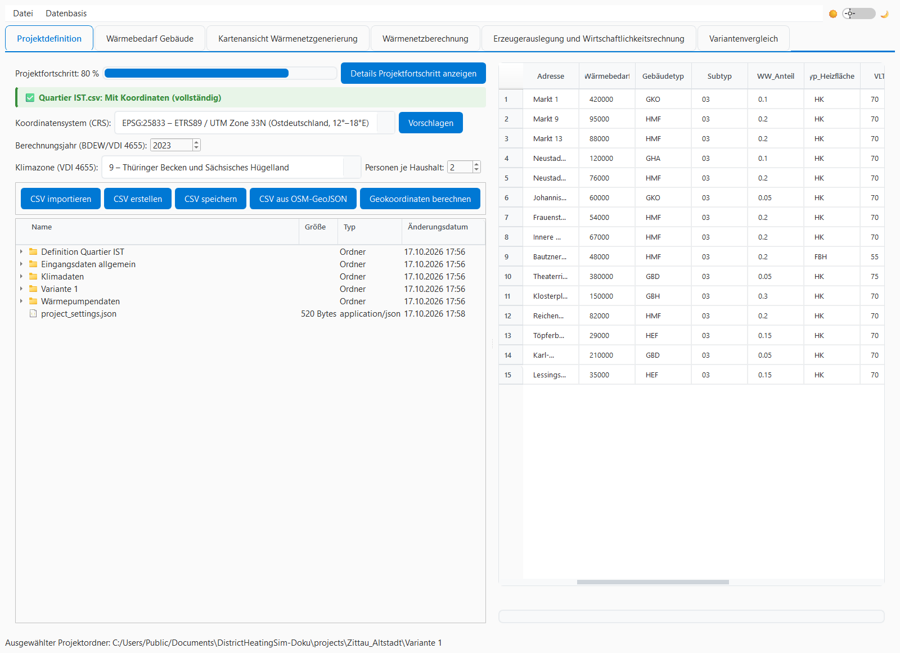

   Reiter *Projektdefinition* nach Import und Geocoding.

**Geokoordinaten berechnen** sucht jede Adresse bei OpenStreetMap (Nominatim, etwa eine Adresse
je Sekunde). Danach meldet das Programm, was nicht eindeutig war, und färbt die Zeilen:

* *nicht gefunden* – die Adresse prüfen,
* *nur Straße gefunden* – meist eine unbekannte Hausnummer; das Gebäude liegt dann irgendwo an
  der Straße,
* *nur Ort gefunden* – die Koordinate ist der Ortsmittelpunkt und für das Netz unbrauchbar,
* *gleicher Punkt* – mehrere Gebäude teilen sich eine Koordinate.

Die Fortschrittsanzeige oben zeigt, welche Schritte erledigt sind; **Details Projektfortschritt
anzeigen** nennt die fehlenden Dateien. Liegen Ihre Koordinaten außerhalb des eingestellten
Koordinatensystems, schlägt **Vorschlagen** ein passendes vor und rechnet die Gebäudeliste um.

4. Wärmebedarf berechnen
------------------------

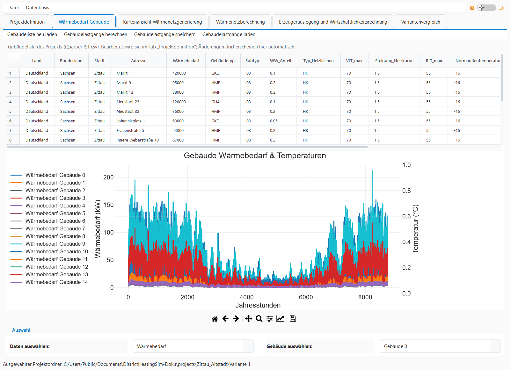

   Reiter *Wärmebedarf Gebäude* mit den Lastgängen.

Im Reiter *Wärmebedarf Gebäude* berechnet **Gebäudelastgänge berechnen** die Stundenlastgänge
aller Gebäude mit dem TRY und der Klimazone des Projekts. Das Diagramm zeigt die Gebäude einzeln
oder zusammen. Die Gebäudeliste ist hier schreibgeschützt; bearbeitet wird sie in der
*Projektdefinition*.

Liegt das TRY weit vom Projektort entfernt, fragt das Programm einmal nach – mit dem
mitgelieferten TRY rechnet ein Projekt in Freiburg sonst mit dem Klima der Oberlausitz.

5. Netz erzeugen
----------------

Straßen laden
~~~~~~~~~~~~~

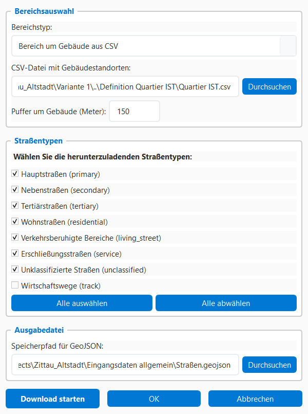

   OSM-Straßenabfrage um die Gebäude.

Im Reiter *Kartenansicht Wärmenetzgenerierung* lädt **Datei → OSM Straßenabfrage** die Straßen
aus OpenStreetMap, im Beispiel in einem Puffer von 150 m um die Gebäude. Für das Verfahren
„OSMnx“ ist dieser Schritt nicht nötig, es lädt die Straßen selbst. Sind die OSM-Server
überlastet, versucht es das Programm dreimal mit Pausen und meldet sich dann verständlich.

Netz generieren
~~~~~~~~~~~~~~~

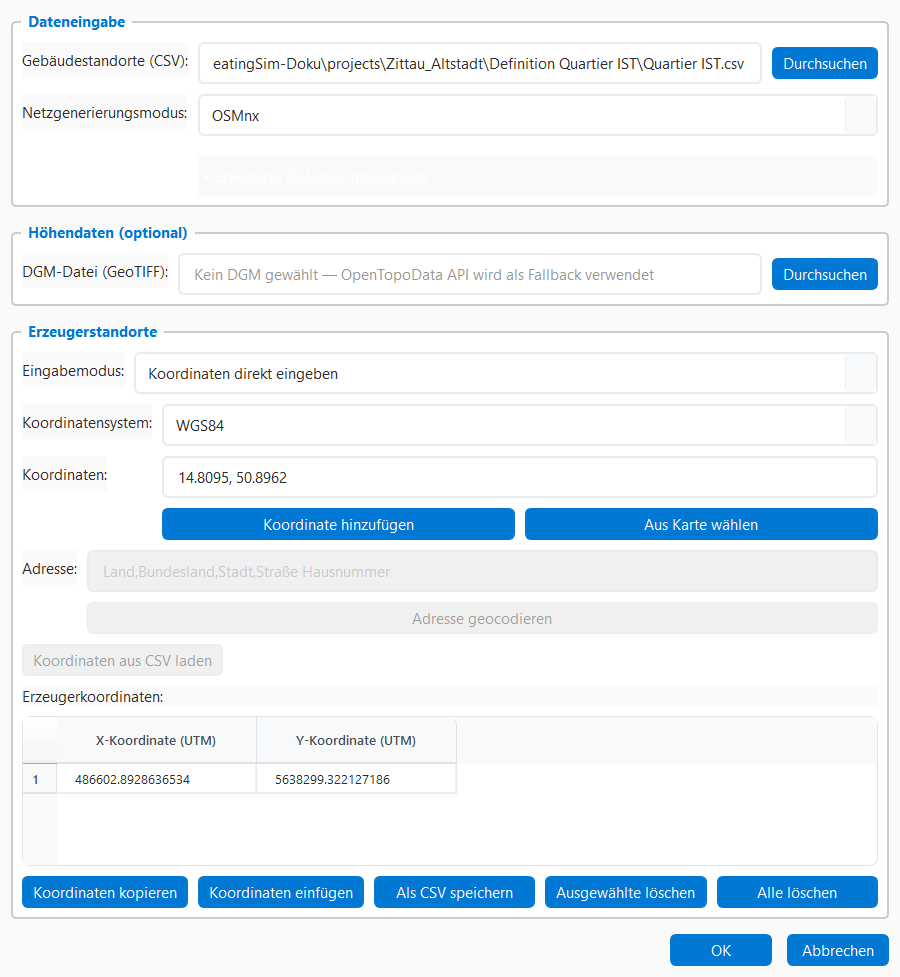

   Netz aus Gebäuden, Straßen und Erzeugerstandort generieren.

**Datei → Wärmenetz aus Daten generieren** öffnet den Dialog:

* **Erzeugerstandort**: Koordinate eingeben (UTM oder WGS84) oder auf der Karte setzen; mehrere
  Standorte sind möglich.
* **Verfahren**: *OSMnx* folgt dem Straßennetz von OpenStreetMap (empfohlen); *MST* verbindet
  die Anschlusspunkte an den geladenen Straßen auf kürzestem Weg, *Advanced MST* legt die
  Leitungen zusätzlich entlang der Straßen. Beide MST-Verfahren brauchen die Straßen aus dem
  vorigen Schritt.

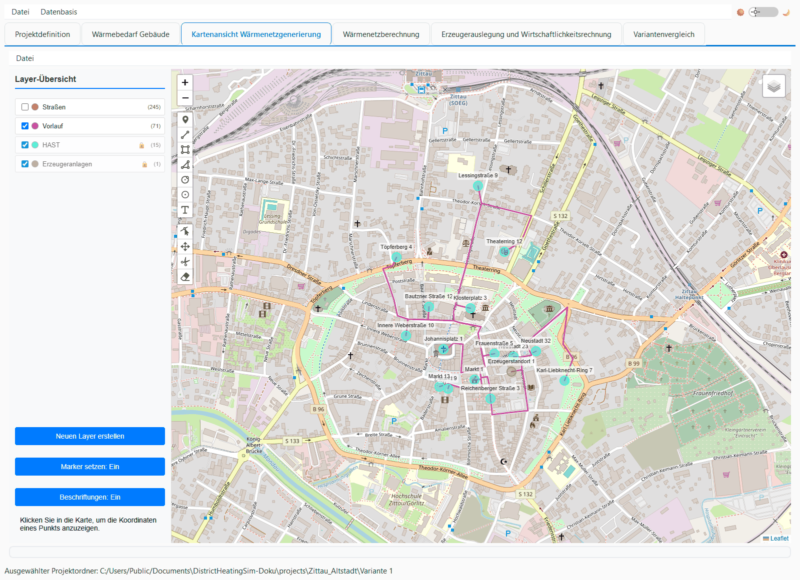

   Das erzeugte Netz: Vorlauf, Hausanschlüsse und Erzeugerstandort.

Die Karte zeigt den **Vorlauf**; Rücklauf und Hausanschlüsse folgen ihm automatisch. Bearbeiten
Sie nur den Vorlauf (verschieben, teilen, verlängern) und speichern Sie mit **Datei → Netzwerk
speichern** – Rücklauf und Anschlüsse werden dabei neu gebildet. **Datei → Konnektivität prüfen**
findet getrennte Netzteile und nicht angebundene Gebäude (auf der Karte markiert) und bietet an,
fast berührende Enden zusammenzuziehen.

6. Netz berechnen
-----------------

Netzinitialisierung
~~~~~~~~~~~~~~~~~~~

Im Reiter *Wärmenetzberechnung* startet **Wärmenetz generieren → Netz generieren** die Berechnung
des Auslegungsfalls mit pandapipes. Der Dialog hat vier Reiter; Netzdaten und Erzeugerstandorte
sind meist schon richtig vorbelegt.

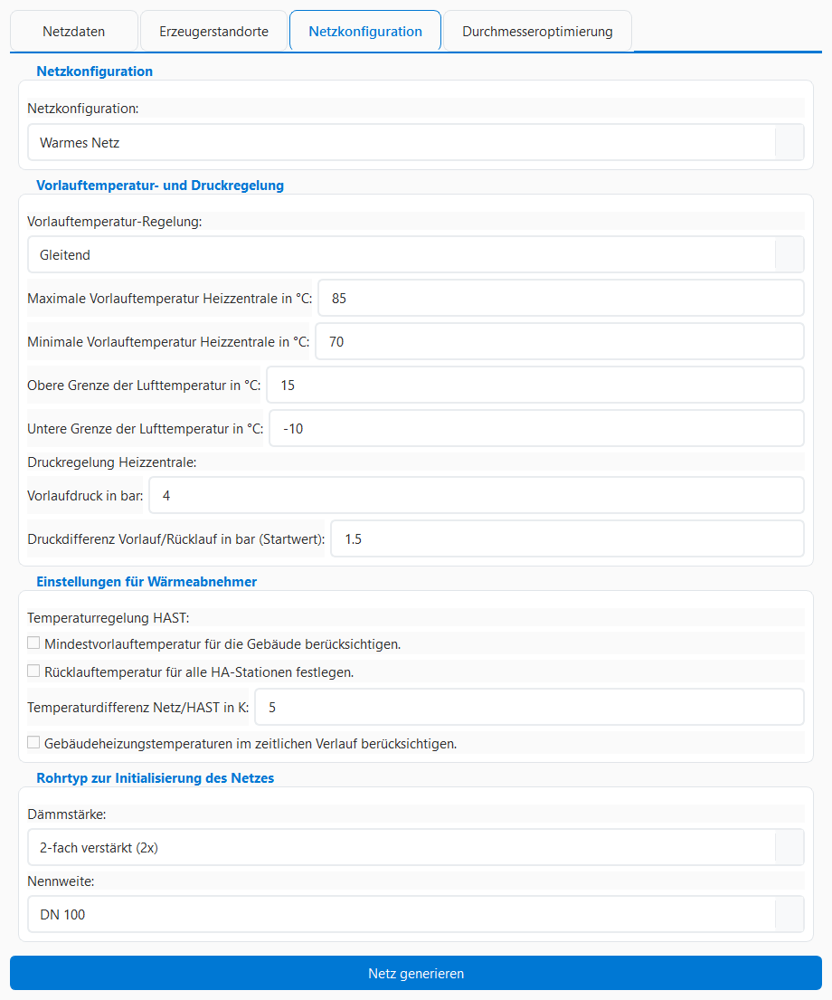

   Netzkonfiguration: Temperaturen, Pumpe und Rohrtyp.

**Netzkonfiguration.** Die Voreinstellung *Warmes Netz* rechnet mit 85/70 °C (gleitende oder
statische Vorlauftemperatur); *Kaltes Netz* rechnet mit Wärmepumpen in den Gebäuden. Der
Pumpendruck ist nur ein Startwert: Die Pumpe wird so ausgelegt, dass am ungünstigsten
Hausanschluss mindestens 1 bar Differenzdruck anliegen. Beim Rohrtyp wählen Sie die Dämmstärke
(Standard, 1-fach oder 2-fach verstärkt) und eine Start-Nennweite.

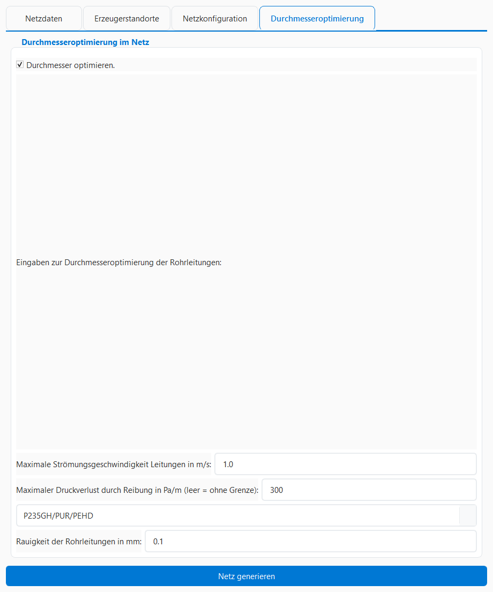

   Durchmesseroptimierung: Grenzen der Rohrdimensionierung.

**Durchmesseroptimierung.** Jede Leitung bekommt die kleinste Nennweite, die die höchste
Strömungsgeschwindigkeit (Standard 1 m/s) **und** den höchsten Druckverlust durch Reibung
(Standard 300 Pa/m) einhält. Mehr dazu in der :doc:`berechnungsmethodik`.

Nach der Berechnung nennt das Programm die Förderhöhe der Pumpe, den Differenzdruck am
ungünstigsten Hausanschluss, die höchste Geschwindigkeit und den höchsten Druckverlust.

Jahreszeitreihe
~~~~~~~~~~~~~~~

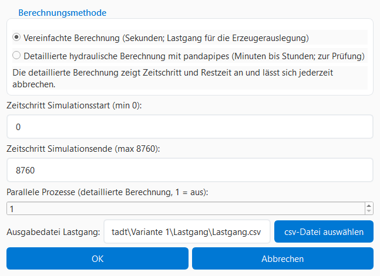

   Zeitreihenberechnung.

**Zeitreihenberechnung durchführen → Zeitreihenberechnung** rechnet das Jahr:

* **vereinfacht** (Standard) – skaliert den Auslegungsfall mit dem Wärmebedarf jeder Stunde; ein
  Jahr dauert Sekunden,
* **detailliert** – jede Stunde eine vollständige Netzberechnung; je nach Netzgröße Minuten bis
  Stunden, mit Fortschritt, Restzeit und **Abbrechen**.

Ergebnisse und Plausibilität
~~~~~~~~~~~~~~~~~~~~~~~~~~~~

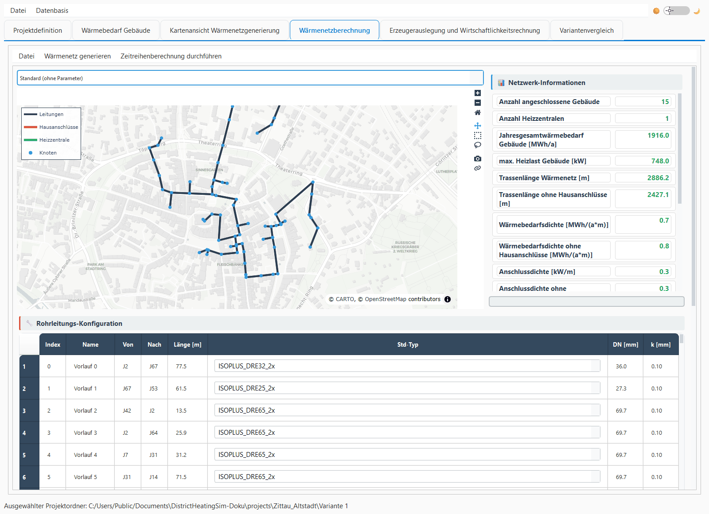

   Netzplot, Kennzahlen und Rohrtabelle.

Der Netzplot zeigt die Leitungen auf der Karte; ein Klick auf eine Leitung wählt sie in der
Rohrtabelle aus. In der Tabelle lassen sich Rohrtypen ändern; geänderte Zeilen sind farbig
hinterlegt, bis neu gerechnet ist. Rechts stehen die Kennzahlen des Netzes, Trassenlänge und
Dichten auch ohne Hausanschlüsse.

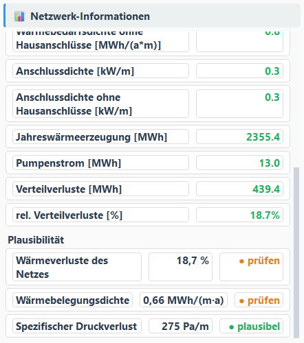

   Plausibilitätsampel des Netzes.

Unter den Kennzahlen bewertet eine **Ampel** die Wärmeverluste, die Wärmebelegungsdichte und den
höchsten Druckverlust (*plausibel*, *prüfen*, *unplausibel*). Der Hinweis mit Grenzwert und
Quelle erscheint beim Zeigen auf eine Karte. Im Beispiel sind die Verluste mit knapp 19 % und die
Belegungsdichte mit 0,66 MWh/(m·a) zu prüfen: Für 15 Gebäude ist die Trasse lang.

Speichern Sie das Netz mit **Datei → Projekt speichern** (Strg+S) oder beim Verlassen des Projekts.

7. Erzeuger auslegen
--------------------

Erzeuger anlegen
~~~~~~~~~~~~~~~~

Im Reiter *Erzeugerauslegung und Wirtschaftlichkeitsrechnung* fügen Sie über **Wärmeerzeuger
hinzufügen** und **Speicher hinzufügen** die Anlagen hinzu. Die Reihenfolge der Liste ist die
Einsatzreihenfolge: Der erste Erzeuger deckt so viel Last wie möglich, der nächste den Rest.
Die Reihenfolge lässt sich mit der Maus ändern.

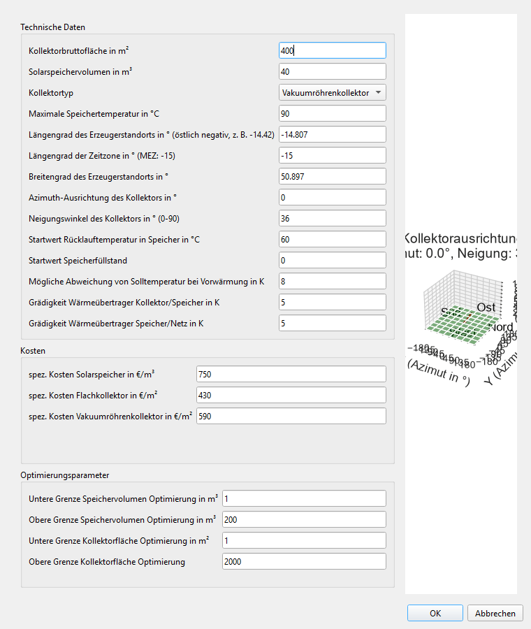

   Eingaben einer Solarthermieanlage.

Jeder Erzeuger hat einen eigenen Dialog mit Leistung, Kosten und, für die Optimierung, Grenzen der
Anlagengröße. Eine neue Solarthermieanlage übernimmt den Projektort.

.. figure:: _static/images/handbuch/hb_17_erzeuger.png
   :width: 100%

   Erzeugerdefinition mit Anlagenschema: Solarthermie, Biomassekessel, Gaskessel.

Mehrere Zusammenstellungen verwalten Sie als **Erzeugerkonfigurationen** (Auswahl oben, **Neu**,
**Speichern als…**, **Löschen**) – im Beispiel „Standard“ und „Nur_Gaskessel“.

Kosten und Berechnung
~~~~~~~~~~~~~~~~~~~~~

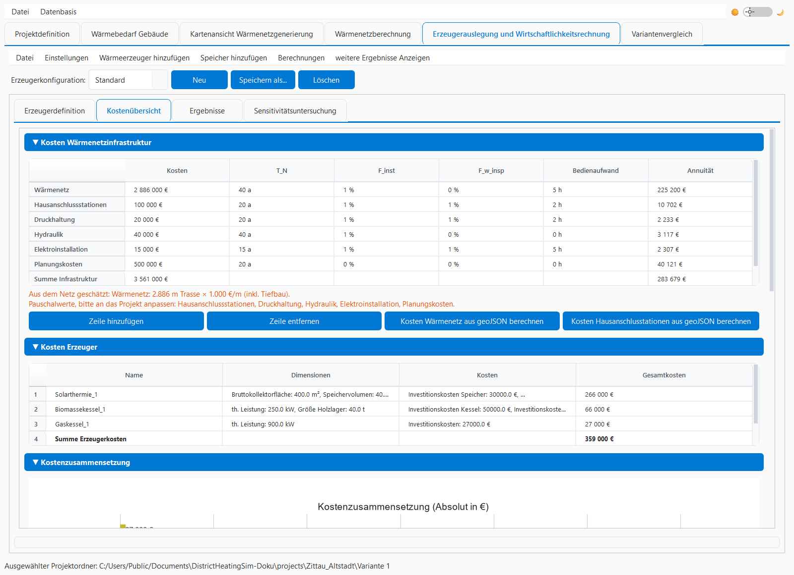

   Kostenübersicht.

Die *Kostenübersicht* zeigt die Investitionen der Erzeuger und der Infrastruktur. Netz und
Hausanschlussstationen schätzt das Programm aus dem berechneten Netz (1000 €/m Trasse, 250 €/kW),
bis Sie eigene Werte eintragen; ein Hinweis unter der Tabelle nennt die Schätzungen. Zins,
Preissteigerung, Energiepreise und Förderung stellen Sie unter **Einstellungen → Wirtschaftliche
Parameter…** ein.

**Berechnungen → Berechnen** rechnet die Konfiguration über das Jahr.

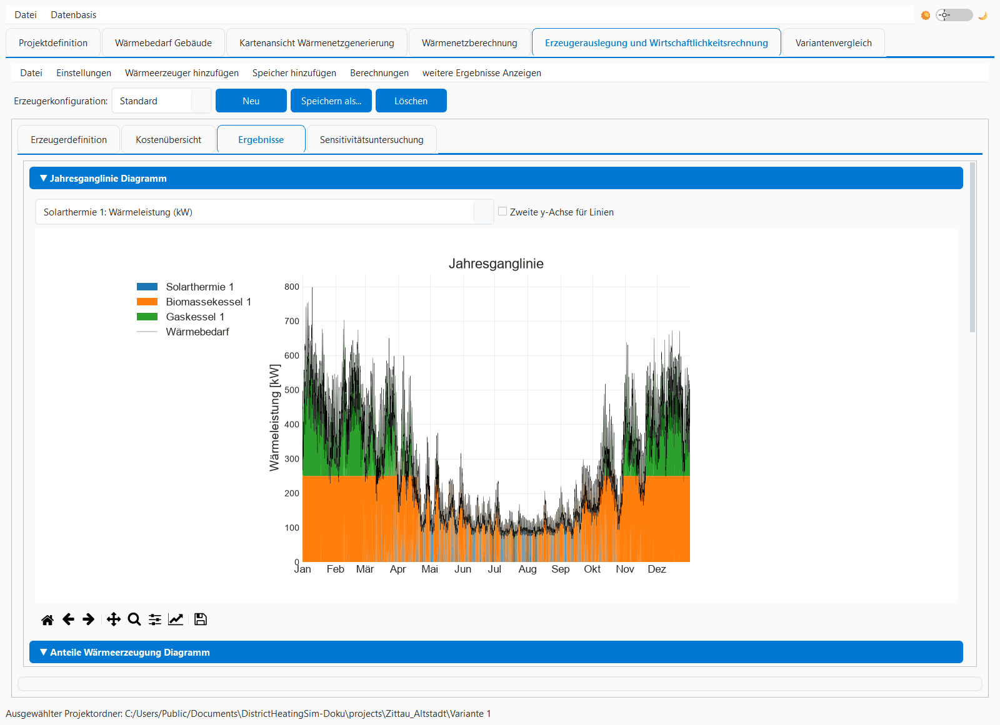

   Ergebnisse: Jahresverlauf der Erzeugung, Anteile der Erzeuger, Kennzahlen.

Die *Ergebnisse* zeigen den Einsatz der Erzeuger über das Jahr, ihre Anteile, Betriebsstunden,
Starts, Wärmegestehungskosten, CO₂ und Primärenergiefaktor, darunter die Gesamtkosten mit
Infrastruktur. **Datei → Ergebnisse als CSV exportieren…** speichert die Zeitreihe,
**weitere Ergebnisse Anzeigen** öffnet das Sankey-Diagramm der Energieflüsse.

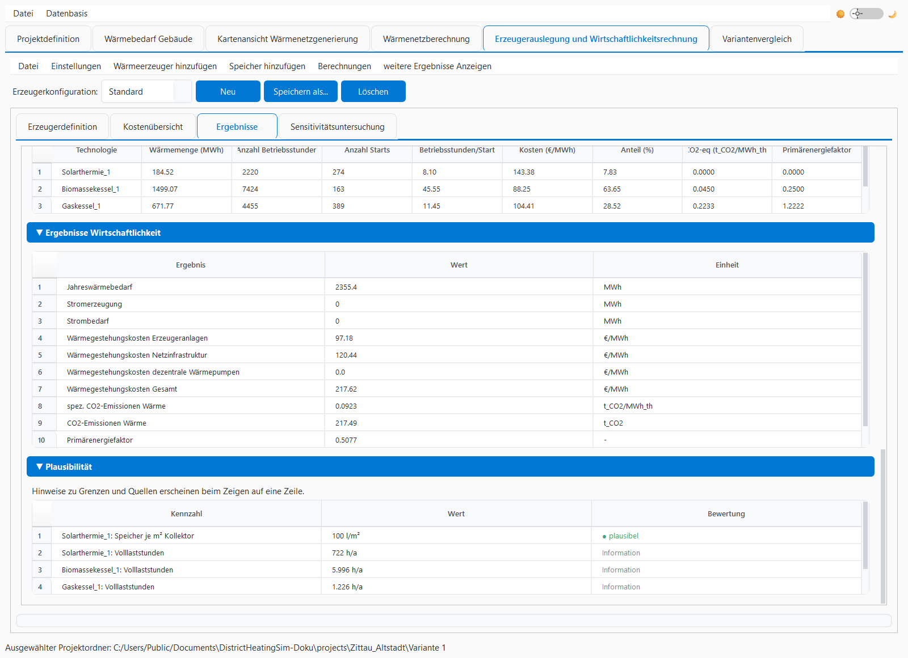

   Plausibilität der Erzeuger.

Auch hier bewertet eine Ampel die Ergebnisse: den Speicher je m² Kollektor einer
Solarthermieanlage (üblich sind 50–100 l/m²) und – als Information – die Volllaststunden je
Erzeuger.

Optimierung
~~~~~~~~~~~

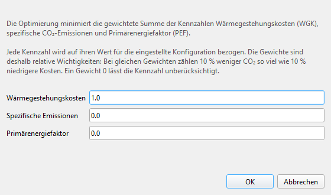

   Gewichte der Optimierung.

**Berechnungen → Optimieren** sucht die Anlagengrößen innerhalb der Grenzen in den
Erzeugerdialogen. Die Gewichte sind relative Wichtigkeiten von Wärmegestehungskosten,
CO₂-Emissionen und Primärenergiefaktor: Bei gleichen Gewichten zählen 10 % weniger CO₂ so viel wie
10 % niedrigere Kosten; Gewicht 0 lässt eine Kennzahl unberücksichtigt. Solarthermie behält
mindestens 50 l Speicher je m² Kollektor. Im Reiter *Sensitivitätsuntersuchung* sehen Sie, wie
sich die Kosten mit den Energiepreisen ändern.

8. Varianten vergleichen
------------------------

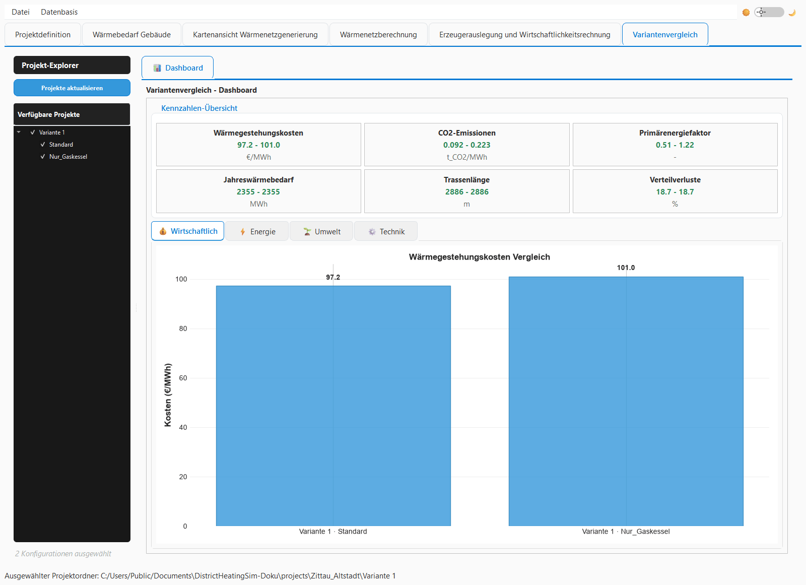

   Variantenvergleich.

Der Reiter *Variantenvergleich* stellt die Kennzahlen aller Varianten und Erzeugerkonfigurationen
nebeneinander. Eine weitere Variante – etwa mit anderer Vorlauftemperatur oder einem anderen
Netz – legen Sie mit **Datei → Variantenkopie erstellen** an; sie übernimmt Gebäude, Netz und
Konfigurationen und wird danach neu berechnet.

Ändern sich Eingaben, nachdem ein Ergebnis berechnet wurde – Gebäude, Lastgänge oder das Netz –,
markiert das Programm die abhängigen Ergebnisse als **veraltet**: in der Fortschrittsanzeige
und im Variantenvergleich mit dem Grund.

Wenn etwas schiefgeht
---------------------

* **Fehlermeldungen** nennen den Schritt, die Ursache und einen Hinweis. Die technischen Details
  stehen in der Logdatei ``%LOCALAPPDATA%\DistrictHeatingSim\logs\districtheatingsim.log``
  (die Meldung nennt den Pfad); hängen Sie sie an eine Fehlermeldung auf GitHub an.
* **Online-Dienste** (Nominatim, Overpass) sind manchmal überlastet. Das Programm versucht es
  mehrmals und meldet sich dann; ein späterer Versuch hilft meist.
* **Netz rechnet nicht** (keine Konvergenz): zuerst **Konnektivität prüfen** – meist ist ein
  Gebäude nicht angebunden oder das Netz in Teile zerfallen.
* **Speichern während einer Rechnung** lehnt das Programm ab; warten Sie das Ende ab oder brechen
  Sie die Zeitreihe ab.
